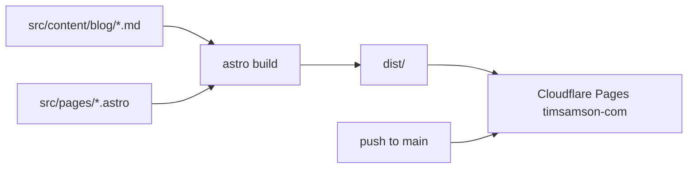

# Architecture

## Is (built)
- Astro `^6.3.3` static site, Tailwind 4 via `@tailwindcss/vite`, `@tailwindcss/typography` (`package.json`, `astro.config.mjs`). Node >=22.12.
- Site URL `https://timsamson.com`.

| Path | Role |
|---|---|
| `src/pages/index.astro` | Home, client-side category filter |
| `src/pages/blog/[slug].astro` | Post template |
| `src/pages/privacy.astro` | Privacy policy |
| `src/layouts/Layout.astro` | Shell, meta, canonical |
| `src/content.config.ts` | Zod schema for `blog` collection |
| `public/_headers` | X-Frame-Options DENY, nosniff, referrer policy, permissions policy |
| `wrangler.toml` | name + compatibility date only; no bindings |

## Deploy
- Pages has a Git provider attached; push to `main` deploys (README.md "Deploy"). Build settings are not in the repo (Q2).

## Planned
- Nothing recorded.
